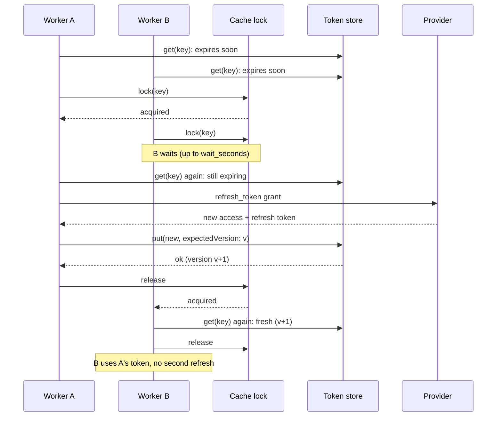

# How it works: preventing concurrent OAuth token refreshes in Laravel

## The OAuth refresh token race condition, step by step

With refresh token rotation, every refresh returns a new refresh token and the provider retires the old one (some immediately, some after a grace period, see [providers.md](providers.md)). Some providers also run refresh token reuse detection: a retired refresh token sent again is treated as a possible leak, and the whole token family is revoked. Salesforce documents this for Refresh Token Rotation; Intuit may revoke QuickBooks tokens on a duplicate refresh.

1. Worker A and worker B both read the token: the access token expires in a few seconds.
2. Both call the token endpoint with the same refresh token.
3. A's call arrives first: the provider issues a new access token and a new refresh token, and retires the old refresh token.
4. B's call arrives with the retired refresh token: `invalid_grant`. With reuse detection, A's new tokens are revoked too.
5. If the app treats `invalid_grant` as "the user disconnected", someone has to reconnect by hand.

The fix is a single-flight refresh: per token, one worker refreshes and the others wait for its result. Runnable examples per provider: [README: providers and examples](../README.md#providers-and-examples).

## One refresh per expiry

1. **Fast path.** A token that does not expire within `skew_seconds` is returned without touching the lock. With `rejected($accessToken)`, the token also needs a refresh while it is still that access token, whatever its expiry; a token another worker has already replaced is returned at once.
2. **One lock per key.** Workers that need a refresh take `lock_prefix + key` from the configured cache store and wait up to `wait_seconds` for it.
3. **Read again inside the lock.** The worker that waited usually finds the token the previous holder just stored and returns it. The same check runs again here, including the rejected access token.
4. **Compare-and-swap write.** The refreshed token is stored only if the stored version is still the one that was read. If someone else wrote in the meantime, their write wins: after a reconnect the new token is returned, after a disconnect the caller gets `TokenNotFound`.

Writes from the app (connect, reconnect) are unconditional, and the store decides their version: an existing key moves to version + 1, a new key starts from a time-based value. So a worker holding an old read can never win a compare-and-swap against a newer connection, even one made after the key was forgotten.

## Distributed lock or conditional write?

A common answer to this race is "use a conditional write, not a distributed lock". The package uses both, because each closes a different gap:

- **The lock** (one `Cache::lock` per token key) stops the second refresh from being sent at all. A conditional write alone lets both workers call the provider; the loser's write is rejected, but its refresh call may already have retired the winner's token or triggered reuse detection.
- **The compare-and-swap write** protects the store when the lock is not enough: a reconnect while a refresh is running, or a refresh that outlives its lease. Without it, a slow worker could overwrite a newer token with an older one.
- **The re-read inside the lock** is what makes waiting useful: the worker that waited finds the token the first worker stored and returns it.

## A refresh that outlives the lock

The lock is a lease of `lock_seconds` (lease expiry is the one way two refreshes can still overlap). If the provider call takes longer:

1. Worker A is still waiting for the provider; its lease has expired.
2. Worker B takes the lock, reads the token, sends the same refresh token. If A's refresh already went through, the provider answers `invalid_grant`, and B stores the token as revoked and throws `TokenRevoked` (and dispatches `TokenRevokedByProvider`).
3. A's call returns the new, valid tokens. A's compare-and-swap fails because B wrote. A sees a revocation of exactly the generation it rotated (`revokedFromVersion`), so the revocation was caused by its own rotation, and it stores its valid tokens (and dispatches `TokenRefreshed`).

This only helps if the provider still accepts A's new tokens. Providers with a grace period for the previous refresh token (Xero) or no revocation on reuse may; providers that punish reuse may revoke the whole connection, A's new tokens included (Salesforce with Refresh Token Rotation; Intuit may). Then the user has to connect again whatever the package stores. B's caller has seen `TokenRevoked` in any case.

Keep the refresh call's HTTP timeout well below `lock_seconds` so this does not happen, and check the stored token before acting on a revocation event.

## When the lock store fails

Laravel 10–12's database lock can hit a deadlock on MySQL when many workers compete for the lock row. A concurrency error while acquiring the lock means only that the worker lost the race, so it keeps waiting. Once the refresh has started, nothing is retried, so the provider is never called twice by one worker.

## Classifying errors

What the refresher throws decides what happens to the token. `DefaultErrorClassifier`, in order:

| Error | Class | Token |
|---|---|---|
| Network error (PSR-18, Guzzle connect error, Laravel `ConnectionException`), HTTP 408, 429, 5xx | Temporary → `TransientRefreshFailure` | Kept |
| OAuth error `temporarily_unavailable`, `server_error` | Temporary → `TransientRefreshFailure` | Kept |
| OAuth error `invalid_grant` | Revoked → `TokenRevoked` | Marked revoked |
| Anything else | Unexpected → the original exception | Kept |

The HTTP status wins over the response body, because gateways and struggling providers return odd bodies. Only `invalid_grant` revokes: wrongly revoking forces a user to reconnect, while a kept token costs one more failed attempt. The list of revoking and temporary codes can be changed through the classifier's constructor, or the classifier replaced.

The classifier reads errors from league/oauth2-client (`IdentityProviderException`), Guzzle, Laravel's HTTP client and PSR-18 clients. None of these packages is required.

## Events

Events are collected while the lock is held and dispatched after it is released, so slow listeners never extend the lock. A listener's exception reaches the caller, as with any synchronous Laravel listener; the token has already been stored by then.
